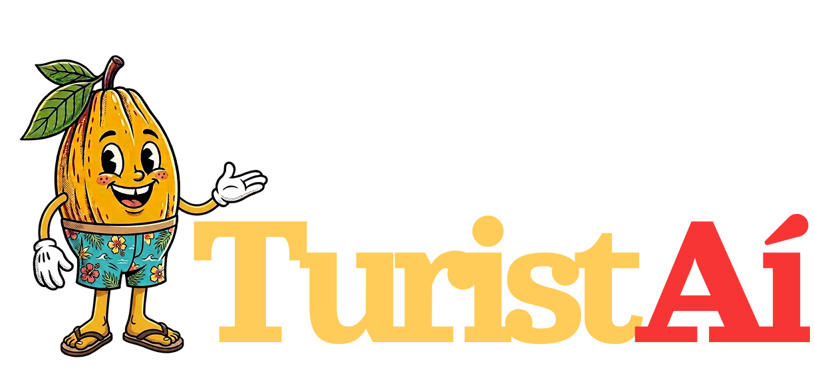

<div align="center">



# TuristAí

**Serviços públicos, trade e turista conectados na Costa do Cacau, no idioma de quem visita**

Alertas oficiais, praias do dia, passeios, lugares recomendados e um SOS com triagem, em português, espanhol e inglês, sem instalar nada


[Sobre](#sobre) · [Telas](#as-telas) · [Assistente e SOS](#o-assistente-e-a-triagem-do-sos) · [IA](#e-a-inteligência-artificial) · [Arquitetura](#arquitetura) · [Como rodar](#como-rodar) · [Equipe](#equipe)

**[Abrir a demo → turistai.vercel.app](https://turistai.vercel.app)**

</div>

## Sobre

O TuristAí nasceu no **Hack Turismo Costa do Cacau** (Desafio 3: *Plataforma Integrada de Serviços, Segurança e Experiência do Visitante*), promovido pelo **SEBRAE** com o **NIT da UESC**, em 28 e 29 de outubro de 2026, na Universidade Estadual de Santa Cruz, em Ilhéus (BA). Foi feito em dois dias por uma equipe de cinco pessoas.

A Costa do Cacau reúne oito municípios (Canavieiras, Ilhéus, Itabuna, Itacaré, Pau Brasil, Santa Luzia, Una e Uruçuca), e a experiência de quem chega ainda é fragmentada:

- **alertas sem canal**: bandeira vermelha, mar agitado e água imprópria chegam por placa, PDF ou boca a boca, e o hotel raramente fica sabendo antes do hóspede;
- **sem idioma**: a Bahia recebeu 202.335 estrangeiros em 2025, e quase nada atende o visitante em espanhol ou inglês;
- **serviços isolados**: saúde, polícia e bombeiros não conversam com hotéis, guias e barracas;
- **trade pouco visível**: 77,6% dos 388 meios de hospedagem da região são microempresas, com pouca presença digital.

A proposta é uma camada única entre o poder público, o trade e o turista: a prefeitura publica um alerta, ele aparece traduzido no celular do turista e no painel do hotel, e se algo der errado o turista aciona um SOS que chega à Central já em português, com o hotel de origem e a localização.

> [!NOTE]
> Este repositório guarda o **MVP do hackathon**. Os estabelecimentos são fictícios (nomes, endereços e telefones inventados). Os atrativos turísticos são lugares públicos reais, e as fotos têm licença livre, com créditos no rodapé do app.

## As telas

| Rota | Para quem | O que tem |
|---|---|---|
| [`/`](https://turistai.vercel.app/?origem=pousada-mare&lang=es) | Turista (abre pelo QR do hotel) | Alertas do dia ao vivo, praias com a bandeira de hoje, **O que fazer** (trilhas, mirantes, passeios e cultura), **Recomendados** com detalhes e contato, mapa, assistente e SOS. Troca de cidade e de idioma. |
| [`/chat`](https://turistai.vercel.app/chat?lang=es) | Turista, pelo "WhatsApp" | Simulação do canal de WhatsApp com o assistente **Cacauzito**: visual de celular no telefone e de WhatsApp Web no computador. Emergências escritas na conversa viram chamado na Central. |
| [`/central`](https://turistai.vercel.app/central) | Central Integrada | Fila de chamados por serviço (Polícia, SAMU, Bombeiros, Atendimento ao Turista), tempo de espera, assumir, encaminhar, responder ao turista no idioma dele e encerrar. Mapa da operação e a ficha da triagem. |
| [`/gestao`](https://turistai.vercel.app/gestao) | Secretaria de turismo | Publicar alerta a partir de modelos já traduzidos, alertas ativos, balneabilidade do dia, SOS ao vivo e os indicadores de **alcance**, **segurança** e **economia**. |
| [`/ensaio`](https://turistai.vercel.app/ensaio) | Equipe, na apresentação | Prepara a demo: publica o alerta da Concha, gera chamados de exemplo e limpa tudo. |

Destaques da tela do turista:

- **Idioma automático**: detecta o idioma do celular (PT, ES ou EN) e deixa trocar a qualquer momento.
- **Contexto do QR**: `?origem=pousada-mare` faz o app saber de qual hotel o turista veio. As distâncias são contadas a partir dele, e o hotel vai junto no SOS.
- **Selo TuristAí**: os recomendados mostram o Selo e, só nas atividades em que a lei exige (hospedagem, agências, guias e transporte turístico), o Cadastur.
- **Cidades**: Itacaré e Ilhéus já têm conteúdo; os outros seis municípios aparecem como "em breve".

### Roteiro da demo (menos de 3 minutos)

1. O celular em espanhol abre `/?origem=pousada-mare&lang=es`, como se tivesse lido o QR da pousada.
2. Em outra aba, `/gestao` (ou `/ensaio`) publica **bandeira vermelha na Praia da Concha**.
3. O alerta aparece na hora no celular, em espanhol, e a Concha passa para "imprópria".
4. O turista pergunta ao assistente: *"¿Dónde puedo comer?"*.
5. SOS em texto livre: *"me robaron el celular con un cuchillo"*. A Central recebe "Roubo de celular com faca", urgente, com o hotel de origem.
6. SOS *"perdí mi pasaporte"*: o próprio app resolve com os passos, e o chamado não entra na fila urgente.
7. O atendente assume o chamado e os indicadores mudam.

## O assistente e a triagem do SOS

Os dois "agentes" rodam no servidor, em rotas do próprio Next.js, e respondem em **streaming** (um evento por linha, em NDJSON). Assim a tela mostra o raciocínio em etapas discretas, como *"consultando praias… → 3 de 4 praias próprias"*, antes da resposta.

**Guia turístico** (`/api/agente/guia`)

- Entende perguntas em PT, ES e EN sobre praias (inclusive pelo nome: *"a Concha está boa hoje?"*), alertas, passeios, onde comer, hospedagem, transporte, compras, vida noturna, clima e maré, preços e o que é o Selo. Responde a mais de um assunto na mesma frase.
- Só usa os dados do app: alertas ativos, praias do dia, atrativos e estabelecimentos com Selo. Quando não há um lugar recomendado para algo, ele diz isso em vez de inventar.
- Ao perceber uma emergência, aponta o SOS. Casos simples, como documento perdido ou picada de água-viva, ele mesmo resolve com passos.

**Triagem do SOS** (`/api/agente/sos`)

- Lê o texto livre e procura sinais: o que aconteceu (roubo, agressão, afogamento, dor no peito…), se há arma, se envolve criança, onde foi e se está acontecendo agora.
- Classifica em **saúde, segurança, mar, pessoa perdida, documento ou informação**, sugere o serviço e decide a urgência. A regra é **na dúvida, urgente**.
- Monta a **ficha para a Central** em português: resumo, tipo, urgência, idioma, local, hotel de origem e os sinais encontrados no texto. Ao turista devolve uma orientação imediata no idioma dele.
- O urgente vai direto para a fila; o não urgente o próprio app resolve. Os números 190, 192 e 193 ficam sempre à vista.

Exemplos reais da triagem:

| Mensagem | Ficha |
|---|---|
| *me robaron el celular en la playa, un hombre con cuchillo* | Urgente · Segurança · Polícia: "Roubo de celular com faca, na praia" |
| *mi hijo de 5 años se perdió en el sendero de la Prainha* | Urgente · Pessoa perdida · Bombeiros: "Criança perdida, na Trilha da Prainha" |
| *ayer me robaron la billetera en la calle* | Não urgente: passos do boletim online e do bloqueio de cartões |
| *ayuda por favor* | Urgente, sem serviço definido: um atendente decide |

## E a inteligência artificial?

A versão publicada funciona **só com regras**, sem chamar nenhum modelo externo. É uma escolha da demo, não do produto.

Durante o hackathon chegamos a integrar o **Gemini** pelo **Vercel AI SDK**:

- o guia usava *function calling*, com as ferramentas `consultarAlertas`, `consultarPraias`, `buscarLugares`, `consultarAtrativos` e `pedirSOS`, para responder só com os dados do app;
- a triagem gerava a ficha como saída estruturada, validada com Zod, com uma trava de segurança que subia para "urgente" quando o modelo tinha dúvida.

Funcionou nos testes, mas o plano gratuito da API (20 chamadas por dia por modelo) não aguentava uma apresentação, e não havia verba. Por isso a banca viu a versão por regras.

A arquitetura foi pensada para a IA voltar sem mexer nas telas, porque o contrato entre a tela e o agente (`lib/agente/tipos.ts`) é o mesmo nas duas versões. A versão com Gemini está no histórico, no commit [`9af2daf`](https://github.com/davidmarianosantos/TuristAi/commit/9af2daf). Para trazê-la de volta:

1. Recuperar `web/src/lib/agente/provedor.ts` e as partes com modelo de `guia.ts` e `sos.ts` desse commit, mantendo as regras atuais como reserva para quando a API falhar.
2. Instalar `ai`, `@ai-sdk/google` e `zod`.
3. Definir `GOOGLE_GENERATIVE_AI_API_KEY` em `web/.env.local` e nas variáveis do projeto na Vercel. `AGENTE_MODELO` escolhe o modelo; o `gemini-3.5-flash` respondeu em cerca de 2 segundos nos testes.

## Arquitetura

```
web/                          app Next.js (é a pasta raiz na Vercel)
├─ src/app/                   rotas: / · /chat · /central · /gestao · /ensaio
│  └─ api/agente/             guia e sos: route handlers com resposta em NDJSON
├─ src/components/
│  ├─ turista/                tela do turista (cabeçalho, praias, atrativos, recomendados, SOS, rodapé)
│  ├─ chat/                   WhatsApp simulado
│  ├─ central/                Central Integrada
│  ├─ gestao/                 painel da secretaria de turismo
│  └─ ui/                     peças compartilhadas (folha, bandeira)
├─ src/data/
│  ├─ tipos.ts                modelo de dados
│  ├─ seed.ts                 dados de exemplo (municípios, praias, atrativos, estabelecimentos)
│  └─ repositorio.ts          a única porta das telas para os dados
├─ src/lib/
│  ├─ agente/                 guia, triagem, textos das etapas e cliente do streaming
│  ├─ central/                serviços, fila e ações da Central
│  └─ chatbot/                motor do WhatsApp simulado
├─ src/i18n/textos.ts         textos das telas em PT/ES/EN
└─ public/img/                logo, mascote e fotos com licença livre
docs/                         glossário, ADRs e planos
```

**Dados e tempo real.** Todas as telas falam só com a interface `Repositorio`. No MVP ela é um mock: os alertas, chamados e sessões ficam no `localStorage` do navegador, e um `BroadcastChannel` avisa as outras abas quando algo muda. Por isso, publicar um alerta numa aba faz ele aparecer na hora na outra. Isso vale entre abas do **mesmo navegador**; para funcionar entre aparelhos, o plano é trocar o mock por Supabase (Postgres + Realtime) atrás da mesma interface.

**Decisões registradas** em [`docs/adr/`](docs/adr): o Selo é booleano; o alcance é medido pelas entregas que a tela do turista registra; a gestão publica alertas a partir de modelos já traduzidos. O vocabulário do domínio está em [`docs/GLOSSARY.md`](docs/GLOSSARY.md).

## Como rodar

Requer Node.js 20 ou mais recente.

```bash
cd web
npm install
npm run dev
```

Depois abra:

- Turista vindo do QR da pousada: <http://localhost:3000/?origem=pousada-mare&lang=es>
- Turista em Ilhéus: <http://localhost:3000/?lang=en&cidade=ilheus>
- WhatsApp simulado: <http://localhost:3000/chat?lang=es&origem=pousada-mare>
- Central: <http://localhost:3000/central>
- Gestão: <http://localhost:3000/gestao>
- Ensaio da demo: <http://localhost:3000/ensaio>

Dica: abra o turista, a Central e a gestão **em abas do mesmo navegador** para ver o tempo real funcionando. `?whatsapp=1` força o convite do WhatsApp de novo.

Antes de abrir um PR, rode `npx tsc --noEmit` e `npm run build` dentro de `web/`.

**Deploy.** O projeto está na Vercel com **Root Directory = `web`**. Cada push na `main` publica em [turistai.vercel.app](https://turistai.vercel.app). Sem IA, não há variável de ambiente obrigatória.

## Equipe

Feito no Hack Turismo Costa do Cacau 2026 por:

- Cibelle Sousa Rodrigues
- David Júnio Mariano dos Santos
- Emanuel Humberto Menezes Cerqueira
- Laisa Pereira da França
- Pedro Freitas

## Créditos

- Fotos com licença livre (Wikimedia Commons e Openverse), com autor e licença na folha **Créditos das fotos**, no rodapé do app e em [`web/src/lib/creditos.ts`](web/src/lib/creditos.ts).
- Mapas © colaboradores do [OpenStreetMap](https://www.openstreetmap.org/copyright).
